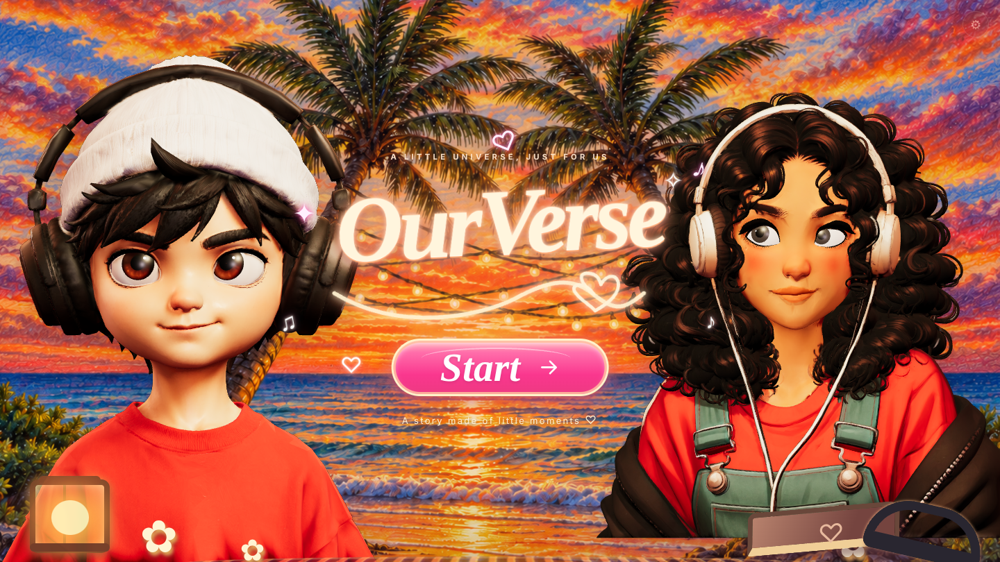
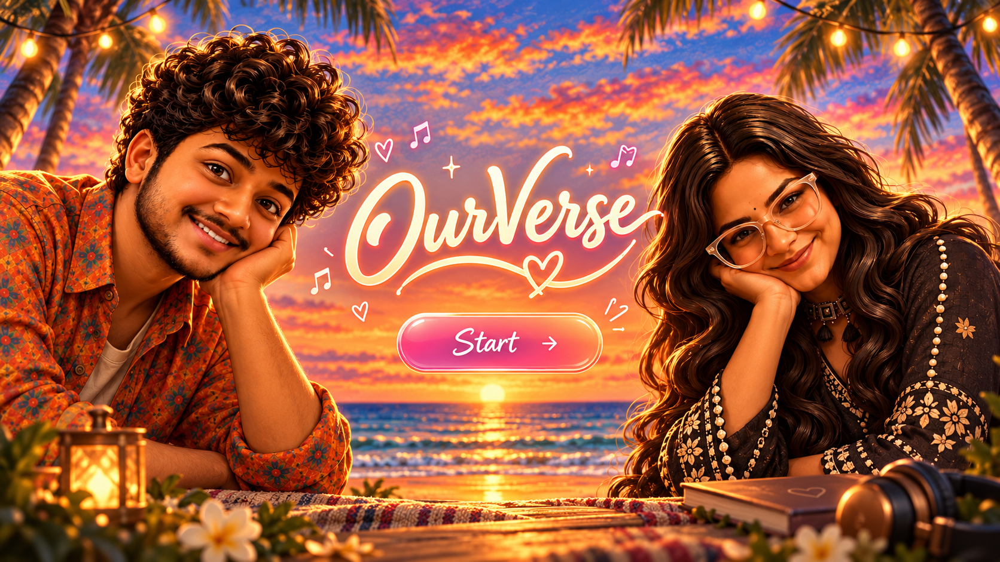
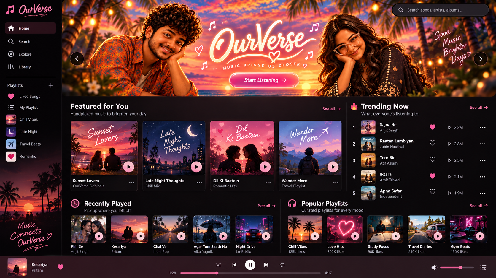

<h1 align="center">OurVerse</h1>

<p align="center"><b>A little universe, just for us: a private music space for two people.</b></p>

<p align="center">
  
  
  
</p>

<p align="center">
  
</p>

OurVerse is a web app for two people. They pair their accounts with an invite code, share their favourite Spotify songs with each other, and send recordings of their own voice singing the same songs. Everything stays private to the two of them.

It opens on a **3D landing page**: two hand-rigged characters on a sunset beach whose heads and eyes follow your cursor in real time.

Built with **TypeScript**, **Vite**, **three.js** and **Firebase**.

## What's built

### Pairing
- **Firebase Auth** with persistent sessions
- **Unique invite codes:** one partner creates a code, the other joins with it
- **Transaction-safe joins** and a **one-pair-per-user** rule, so two people can never claim the same pair at once
- **Pair state is independent of login sessions:** signing out or switching devices never breaks the pair

### Private by design
- **Pair-isolated data:** Firestore documents and Cloud Storage files are readable and writable only by the two members of that pair
- **Security Rules with UID authorization** enforce that on the server, not just in the app
- **App Check** blocks requests that don't come from the real app
- **Validated private uploads** for personal voice recordings

### Music
- **Share favourite songs** from Spotify with your partner
- **Sing them yourself:** record your own voice singing the same song and send it to your partner as a private upload
- Spotify content and personal recordings are kept in **separate data flows**

### Performance
- **Scoped real-time listeners** that subscribe only to the data on screen, with **pagination** and **incremental updates**
- **Debounced search** and **caching**
- **Optimized GLB models and textures**, **lazy loading** and **mobile fallbacks**

### Cursor-tracking 3D characters
- **Two custom characters** (boy and girl) rigged in **Blender** with a `Root → Neck → Head → Eye.L / Eye.R` armature and exported as **GLB**.
- **Bone lookup that survives export:** three.js renames `Eye.L` to `EyeL` on load, so bones are matched by a normalized, letters-and-digits-only name.
- **Natural motion:** the head turns a little and the eyes turn more, so the characters *look* at the cursor before turning toward it. Each bone rotates from its rest pose around yaw and pitch axes with **per-bone degree limits**, then eases there with quaternion `slerp`.
- **Frame-rate-independent smoothing:** cursor following uses exponential damping (`1 - e^(-k·dt)`), so motion feels the same at 30 or 144 FPS.
- **Auto-framing:** each character gets its own renderer and orthographic camera, fitted to the model's bounding box and the canvas aspect ratio, and refitted on resize.

### Built to behave well
- **Respects `prefers-reduced-motion`**, ignores touch input, and pauses rendering when the tab is hidden
- **Live tuning panel** (press **D** or click ⚙): adjust each character's size, position, body angle, and head and eye strength, with test-look buttons. Settings are saved in `localStorage`.
- **Startup watchdog:** if three.js or WebGL fails to start, the page shows a clear message instead of a blank scene
- **Diagnostics page** ([`check.html`](check.html)) tests the local server, each model file, WebGL support and the three.js imports separately
- **CDN fallback:** [`index_unpkg.html`](index_unpkg.html) loads three.js from a second CDN in case the first is blocked
- **Accessible markup:** ARIA labels, a live status region, and a dialog for the next-chapter screen

### Scene
Sunset beach background art, a glowing script logo, CSS-drawn props (lantern, memory book, headphones, flowers) and a **Start** button that opens the next-chapter screen.

## How the tracking works

```js
// Each frame: start from the bone's rest pose, add a limited yaw/pitch toward the cursor, ease into it.
tempYaw.setFromAxisAngle(YAW_AXIS, yawDegrees * DEG);
tempPitch.setFromAxisAngle(PITCH_AXIS, -pitchUpDegrees * DEG);
tempDesired.copy(neutralQ).multiply(tempYaw.multiply(tempPitch));
control.quaternion.slerp(tempDesired, amount);
```

## Design direction

Concept art for the full app: the landing scene, and the music home with featured playlists, trending songs, recently played and a player bar.

<p align="center">
  
  
</p>

## Roadmap

- [ ] Music home UI matching the concept art above

## Run it locally

The page loads ES modules and 3D models, so it needs a local server (opening `index.html` straight from disk won't work). three.js comes from a CDN, so you need an internet connection and nothing to install.

```bash
node server.cjs              # or: python -m http.server 8947
# open http://localhost:8947/index.html
```

On Windows you can double-click **`run_windows.bat`**. If the characters don't appear, open `http://localhost:8947/check.html`.

## Project structure

```
├── index.html          # Landing page + import map (jsDelivr)
├── index_unpkg.html    # Same page, unpkg CDN fallback
├── check.html          # 3D diagnostics
├── main.js             # CharacterView: loading, rig lookup, framing, tracking, tuning panel
├── style.css           # Scene, typography, props, tuning panel, responsive layout
├── server.cjs          # Zero-dependency local server
├── run_windows.bat     # One-click launcher on Windows
├── assets/bg.png       # Sunset beach background
├── models/             # boy.glb, girl.glb
└── docs/               # Screenshot and concept art
```

---

Built by **Darshil Patel** — [LinkedIn](https://www.linkedin.com/in/darshilkumarpatel1) · [GitHub](https://github.com/Darshil2903)
